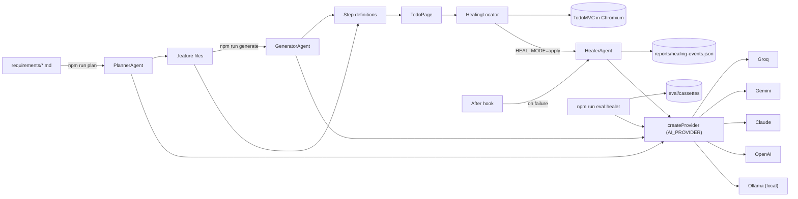

# Playwright + Cucumber + AI Agent Test Framework

[](https://github.com/KKoygun/Playwright-cucumber-ai-framework/actions/workflows/ci.yml)

A portfolio project demonstrating senior-level test automation architecture: **Playwright**, **Cucumber BDD**, **REST API testing**, and a suite of **AI agents** (Healer, Planner, Generator) built on a provider-agnostic adapter pattern.

> All production experience over the past 6 years is in private company repositories. This project exists to make that expertise publicly visible.

---

## What's Inside

| Capability | Implementation |
|---|---|
| UI Test Automation | Playwright + TypeScript |
| BDD Layer | Cucumber with Gherkin feature files |
| Page Object Model | `src/pages/` — selectors and actions in one place |
| REST API Testing | Dedicated framework → [playwright-api-framework](https://github.com/KKoygun/playwright-api-framework) |
| AI Healer Agent | On failure: captures HTML, asks the model for selector fixes; `HEAL_MODE=apply` retries in the same session |
| Healer eval | `npm run eval:healer` — breaks selectors on purpose and scores each provider |
| AI Planner Agent | Reads a requirements `.md` file, generates a `.feature` file |
| AI Generator Agent | Reads a `.feature` file, generates missing step definitions |
| Provider Adapter Pattern | Groq, Gemini, Claude, OpenAI or a local Ollama model, picked with `AI_PROVIDER` |
| Accessibility | axe-core WCAG 2.1 A/AA scans with a committed baseline |
| Unit tests | Providers tested against a fake fetch; healing and eval scoring tested on static pages |
| GitHub Actions CI | Unit tests, parallel tag matrix, healer eval replay, merged HTML + Allure reports |
| Azure Pipelines CI | Templated YAML alongside GitHub Actions |

---

## Architecture



```
src/
├── pages/                  # Page Object Model — all selectors live here only
├── features/               # Gherkin .feature files
├── steps/                  # Step definitions — map Gherkin to page/api calls
├── support/
│   ├── world.ts            # CustomWorld — browser context + API context + healer
│   └── hooks.ts            # Tag-aware Before/After hooks (UI vs @api separation)
├── agents/
│   ├── providers/
│   │   ├── AIProvider.ts       # Interface — the contract all providers implement
│   │   ├── ChatProvider.ts     # Shared healing flow; each provider only implements chat()
│   │   ├── createProvider.ts   # Picks the provider from AI_PROVIDER
│   │   ├── GroqProvider.ts     # Llama 3.3 70B via Groq free tier (default)
│   │   ├── GeminiProvider.ts   # Google Gemini free tier
│   │   ├── ClaudeProvider.ts   # Anthropic Messages API
│   │   ├── OpenAIProvider.ts   # OpenAI Chat Completions API
│   │   └── OllamaProvider.ts   # Local model over HTTP — page data stays on your network
│   ├── HealerAgent.ts          # Analyses failures, saves healing events
│   ├── PlannerAgent.ts         # Generates Gherkin from plain-English requirements
│   └── GeneratorAgent.ts       # Generates step definitions for missing Gherkin steps
├── eval/                   # Healer eval cases and scoring
└── utils/
    ├── HealingLocator.ts    # Runs page actions; heals them in HEAL_MODE=apply
    └── StepParser.ts        # Extracts and matches step patterns (used by generate script)
tests/unit/                 # Unit tests (npm run test:unit)
a11y/baseline.json          # Known accessibility violations
requirements/               # Plain-English feature descriptions (input to PlannerAgent)
scripts/
├── plan.ts                 # CLI: requirements .md → .feature file
├── generate.ts             # CLI: .feature file → missing step definitions
├── eval-healer.ts          # CLI: healer eval (replay / record / check)
└── generate-report.js      # Merges JSON reports into a single HTML report
```

### Why Page Object Model?

Step definitions should read like English, not Playwright API calls. The POM ensures that when a selector changes, there is exactly **one place to fix it** — no ripple effect across step files.

### Why Cucumber over Playwright's native runner?

Playwright's runner is excellent for developer-centric testing. Cucumber adds a **living documentation layer**: non-technical stakeholders can read and write feature files without knowing TypeScript. In teams where requirements come from product owners, BDD pays off significantly.

### Why the Adapter pattern for AI providers?

Hardcoding any single AI provider into the agents means every future provider swap requires touching agent logic. By coding against the `AIProvider` interface, agents never import a specific SDK. Pick the provider in `.env`:

```bash
AI_PROVIDER=ollama   # groq | gemini | claude | openai | ollama
```

or swap the one line in `src/support/world.ts`:

```ts
const provider = createProvider();        // reads AI_PROVIDER
const provider = new OllamaProvider();    // or any provider directly
```

Nothing else changes. This is the **Open/Closed Principle** applied to AI integration.

---

## AI Agents

### Healer Agent

```
Test step fails
    ↓
HEAL_MODE=suggest (default)               HEAL_MODE=apply
After hook captures error + page HTML     HealingLocator catches the failed action
    ↓                                         ↓
HealerAgent → AIProvider.analyzeFailure() → [{ suggestedSelector, confidence, reasoning }]
    ↓                                         ↓
Suggestions attached to the report        Top suggestion retried in the same session
                                          if it matches exactly one element
    ↓                                         ↓
Event saved to reports/healing-events.json (provider, model, latency, tokens, outcome)
```

Suggest mode never changes how a test runs, so it is safe for audited pipelines. Apply mode lets a step continue when the suggestion works, and records the outcome:

| Outcome | Meaning |
|---|---|
| `healed` | The suggestion matched exactly one element and the action succeeded |
| `not_healed` | The suggestion matched zero or several elements, or the retry failed |
| `invalid_suggestion` | No usable selector came back (unparseable reply or invalid syntax) |

A healed run is still a signal to fix the page object — the event log says which selector to change.

### Planner + Generator — AI-assisted test creation pipeline

Starting from a plain-English requirements file, the full pipeline generates working tests:

```
requirements/todo-editing.md          ← plain English ("Jira ticket")
    ↓  npm run plan
src/features/todo-editing.feature     ← Gherkin generated by PlannerAgent
    ↓  npm run generate
src/steps/todo-editing.steps.ts       ← TypeScript step definitions by GeneratorAgent
                                         (only generates steps that don't already exist)
    ↓  npm test
```

**The Generator's skip logic** — when it ran against the generated feature file, it found:

```
[SKIP - already exists]  I am on the TodoMVC application
[SKIP - already exists]  I have added a todo "Buy milk"
[SKIP - already exists]  the todo "Buy eggs" should be visible
[SKIP - already exists]  I have added a todo "Walk the dog"
[SKIP - already exists]  I should see 2 todo items
[GENERATE]               I double-click the todo {string} and type {string} and press Enter
```

5 existing steps reused, 1 genuinely new step generated.

---

## Healer Eval

`npm run eval:healer` measures the Healer instead of trusting it. It loads TodoMVC with three todos, breaks a selector on purpose, and asks each provider to heal it. Nine cases cover four kinds of change: renamed class, removed test id, extra wrapper element and changed text ([`src/eval/cases.ts`](src/eval/cases.ts)).

**Success is objective:** before the mutation the harness remembers the element the original selector found. The suggestion counts as healed only if it finds exactly one element and it is that same element. Close enough does not count.

Model responses are recorded once and replayed after that, so the eval runs in CI without keys:

```bash
npm run eval:record -- --providers=groq          # needs GROQ_API_KEY; saves eval/cassettes/groq/*.json
npm run eval:record -- --providers=ollama        # needs a running Ollama
npm run eval:healer                              # replays every recorded provider
npm run eval:healer -- --check                   # only checks that each case breaks as intended
```

Results go to `reports/eval/results.json` and `results.md` (success rate, top-3 hits, latency, tokens). If the demo page changes after recording, the report says so.

### Results

> **Not recorded yet.** Run `npm run eval:record -- --providers=groq`, then `npm run eval:healer`, and paste the table from `reports/eval/results.md` here.

---

## Accessibility

`@a11y` scenarios scan the page with [axe-core](https://github.com/dequelabs/axe-core) using the `wcag2a`, `wcag2aa`, `wcag21a` and `wcag21aa` rules, and attach any violations to the report.

TodoMVC already has colour-contrast violations, so they are listed in [`a11y/baseline.json`](a11y/baseline.json) and only **new** violations fail a scenario. After fixing or accepting a change, regenerate it with `npm run a11y:baseline` and review the diff.

**Limits:** automated scans only catch part of WCAG — things like keyboard-only navigation, focus order, meaningful labels and screen reader output still need manual checks with a keyboard and a screen reader (NVDA, VoiceOver). A green `@a11y` run does not mean the page is accessible.

---

## Relationship to Playwright's built-in agents

Playwright 1.56 added its own planner, generator and healer ("Playwright Test Agents"), set up with `npx playwright init-agents` and run from an AI coding loop such as VS Code, Claude Code or opencode.

**The same:** three roles with the same split — plan the scenarios, generate the test code, heal broken tests — and the model works from the live page instead of guessing.

**What differs here:**

| | Playwright Test Agents | This framework |
|---|---|---|
| Where it runs | Inside an interactive agent loop | Node scripts and Cucumber hooks, headless in CI |
| Model | Whatever the agent loop uses | Any `AIProvider`: Groq, Gemini, Claude, OpenAI or a local Ollama model |
| Planner output | Markdown test plan | Gherkin `.feature` file |
| Generator output | Playwright Test `.spec.ts` files | Cucumber step definitions, only for missing steps |
| Healer | Edits the test code until it passes | Suggests at runtime, or retries in-session (`HEAL_MODE=apply`); never edits code |
| Audit trail | The diff it proposes | Every attempt in `reports/healing-events.json` with provider, model, latency, tokens and outcome |

They solve different problems: the official healer fixes test code with a developer in the loop, this one keeps an unattended CI run informative and leaves the code change to a person. [docs/official-healer-comparison.md](docs/official-healer-comparison.md) describes how to run the official healer on the same broken selectors for a side-by-side comparison.

---

## Quick Start

**Prerequisites:** Node.js 22+, a free Groq API key from [console.groq.com](https://console.groq.com) (or a local Ollama, no key)

```bash
# 1. Clone and install
git clone https://github.com/KKoygun/Playwright-cucumber-ai-framework
cd Playwright-cucumber-ai-framework
npm install
npx playwright install chromium

# 2. Configure environment
cp .env.example .env
# Edit .env — set AI_PROVIDER and the matching key

# 3. Run all tests
npm test

# 4. Generate HTML report
npm run report
```

Tests run without an API key — the Healer agent is only called on failure, and the framework handles missing keys gracefully.

```bash
npm run test:unit         # unit tests, no network or keys
npm run typecheck
```

---

## Running Tests by Tag

```bash
npm run test:smoke                                       # fast feedback, core paths
npm run test:regression                                  # deeper coverage
npm run test:a11y                                        # accessibility scans
npx cucumber-js --tags "@add or @complete"               # specific feature groups
npx cucumber-js --tags "@api"                            # API tests only (no browser)
npx cucumber-js --tags "not @api"                        # all UI tests
```

| Tag | Scenarios |
|---|---|
| `@smoke` | Core happy-path — fast feedback gate |
| `@regression` | Everything beyond the smoke path |
| `@add` | Todo creation |
| `@complete` | Todo completion |
| `@filter` | Filter (All / Active / Completed) |
| `@delete` | Todo deletion |
| `@clear` | Clear completed |
| `@edit` | AI-generated todo editing scenarios |
| `@a11y` | axe-core accessibility scans |
| `@api` | REST API checks against JSONPlaceholder |

---

## AI Agent Pipeline (try it yourself)

```bash
# Step 1 — write your requirements in plain English
#           (edit requirements/todo-editing.md or create a new file)

# Step 2 — generate a .feature file from requirements
npm run plan
# or: npm run plan -- requirements/your-file.md

# Step 3 — generate missing step definitions
npm run generate
# or: npm run generate -- src/features/your-file.feature

# Step 4 — run the generated tests
npm test
```

---

## CI/CD

### GitHub Actions

- **Typecheck & unit tests** — no keys needed.
- **Tag matrix** — parallel jobs per tag group (including `@a11y`); `@api` jobs skip the browser install. A final job merges the reports into one HTML report and one Allure report.
- **Healer eval (replay)** — runs the eval against recorded responses and uploads `reports/eval/`.

Add `GROQ_API_KEY` as a repository secret so the Healer can run on failures: **Settings → Secrets → Actions → New repository secret**

### Azure DevOps

Templated YAML (`azure-pipelines.yml` + `.azure/steps/test-steps.yml`) with smoke, regression, and API jobs running in parallel. Store `GROQ_API_KEY` as a secret pipeline variable: **Pipelines → Edit → Variables → Add → mark as secret**

---

## Switching AI Provider

Set `AI_PROVIDER` in `.env`; `AI_MODEL` overrides the default model.

| Provider | `AI_PROVIDER` | Default model | Key | Verification |
|---|---|---|---|---|
| **Groq** | `groq` (default) | `llama-3.3-70b-versatile` | `GROQ_API_KEY` — free at [console.groq.com](https://console.groq.com) | Mock-tested; the provider behind the plan/generate example above |
| **Google Gemini** | `gemini` | `gemini-2.0-flash-lite` | `GEMINI_API_KEY` — free at [aistudio.google.com](https://aistudio.google.com) | Mock-tested only |
| **Anthropic Claude** | `claude` | `claude-opus-5-5` | `ANTHROPIC_API_KEY` — [console.anthropic.com](https://console.anthropic.com) | Mock-tested only |
| **OpenAI** | `openai` | `gpt-4.1-mini` | `OPENAI_API_KEY` — [platform.openai.com](https://platform.openai.com) | Mock-tested only |
| **Ollama** (local) | `ollama` | `llama3.1:8b` | none — `OLLAMA_HOST`, default `http://localhost:11434` | Mock-tested only |

"Mock-tested" means the request and response handling is covered by unit tests against a fake HTTP layer; it has not been exercised against the real service in this repo. A provider moves to "verified live" once it has recorded eval results.

All three agents (Healer, Planner, Generator) switch automatically — they code against the `AIProvider` interface, never against a specific SDK. With Ollama, page HTML never leaves your machine, which matters when the app under test holds customer data.

---

## Target Application

[https://demo.playwright.dev/todomvc](https://demo.playwright.dev/todomvc) — the official Playwright TodoMVC demo. Publicly available, no authentication required.

For REST API testing see the companion repo: [playwright-api-framework](https://github.com/KKoygun/playwright-api-framework)
